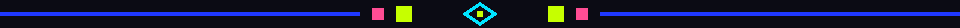
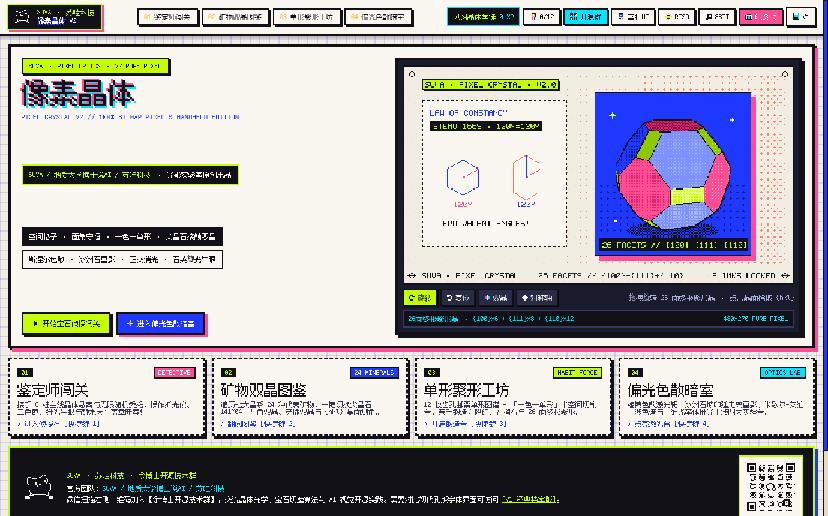
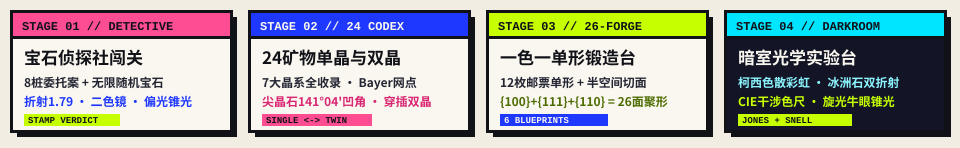
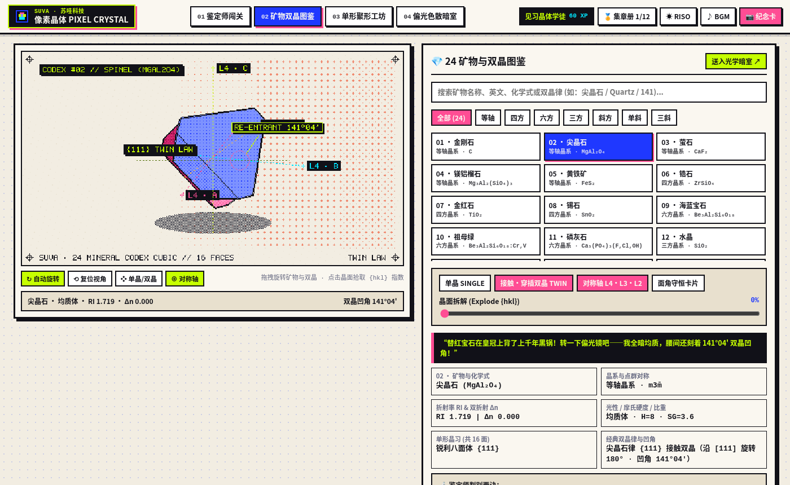

<div align="center">

<a href="https://yuyou-dev.github.io/PixelCrystal/">
  
</a>

<br/>

<a href="https://yuyou-dev.github.io/PixelCrystal/">
  
</a>

<br/><br/>

[](https://github.com/yuyou-dev/PixelCrystal)
[](https://yuyou-dev.github.io/PixelCrystal/)
[](#%E8%A7%86%E8%A7%89%E4%B8%8E%E5%85%89%E5%AD%A6%E5%86%85%E6%A0%B8-prisma-pixel-optics)
[](./LICENSE)

**「把枯燥的晶体对称、一色一单形与偏光锥光干涉，装进一盘 60 FPS 荧光孔版像素街机卡带。」**  
由 **SUVA · 苏哇科技（SUVA Tech）** 原创出品 · 脱胎自《晶体小剧场》，融合 **PRISMA PIXEL OPTICS** 三色孔版（Risograph）与光学暗室像素短片视觉美学。



</div>

---

## 🕹️ 实机像素演示 · LIVE PIXEL GAMEPLAY

<div align="center">

<a href="https://yuyou-dev.github.io/PixelCrystal/">
  
</a>

<br/><br/>



</div>

| `STAGE 01` · 宝石侦探社闯关 | `STAGE 02` · 24 矿物单晶 ↔ 双晶 |
| :---: | :---: |
| <br/><sub><b>五站光学取证 + 盖章结案</b>：折射仪 `1.79 OTL`、二色镜、正交偏光与锥光干涉破获「尖晶石假冒红宝石」等 8 桩悬案</sub> | <br/><sub><b>7 大晶系 24 矿物</b>：`4×4 Bayer` 有序网点像素渲染，一键复刻尖晶石 `{111}` 接触双晶经典 `141°04'` 凹入角</sub> |
| **`STAGE 03` · 一色一单形 26 面锻造台** | **`STAGE 04` · 暗室光学实验台** |
| <br/><sub><b>12 枚像素邮票单形 + 实时半空间切面</b>：`粉红墨 {100}` × `钴蓝墨 {111}` × `荧光黄绿 {110}` 实时锻造 **26 面体**</sub> | <br/><sub><b>暗室物理真算</b>：柯西棱镜色散 `n(λ)`、冰洲石双折射走离、CIE 1931 干涉色尺与石英旋光牛眼锥光图</sub> |

<div align="center">
  
</div>

---

## 🎮 四大街机卡带模式 · GAME MODES

### 1️⃣ `GEM DETECTIVE` · 宝石侦探社（核心闯关玩法）
化身像素宝石鉴定侦探，接手 **8 桩经典晶体学委托案 + 无限随机种子案件**（如「王冠上的假红宝：尖晶石 vs 红宝石」、「夜明珠之谜：萤石解理八面体 vs 钻石」、「双影密信：冰洲石双折射 vs 石英」）：
- **五台像素鉴定仪联动**：
  1. **阿贝宝石折射仪**：真实模拟 `n = 1.79` 接触液上限（钻石/锆石直接触发 `OTL 超限警报`）与双折射阴影带跳动 `Δn`。
  2. **方解石二色镜**：实时对比各向同性单色窗 vs 一轴/二轴晶多色性双窗（如红宝石紫红/橙红二色性、堇青石三色性）。
  3. **正交偏光镜（`P ⊥ A`）**：旋转载物台 `360°`，分辨**全暗均质体**、**异常消光**与**四次明暗消光**。
  4. **锥光镜（贝克氏镜）**：点亮像素级 Jones 矩阵干涉图——一轴晶黑十字、**水晶旋光彩色牛眼心**、二轴晶双曲线分合（`2V` 角）。
  5. **像素晶形放大镜**：观察面角守恒、晶面条纹与接触/穿插双晶凹入角。
- **盖章结案系统**：锁定真身矿物并盖下像素火漆章，获得 `★★★` 评级、连胜积分与可导出的 **邮票鉴定纪念卡 PNG**。

### 2️⃣ `24 MINERAL CODEX` · 像素矿物与双晶图鉴
收录等轴、四方、三方、六方、斜方、单斜、三斜 **七大晶系共 24 种代表宝石与矿物**（金刚石、尖晶石、石榴石、萤石、黄铁矿、锆石、金红石、水晶、方解石、刚玉红/蓝宝石、电气石、绿柱石海蓝宝/祖母绿、黄玉、橄榄石、十字石、正长石、石膏、蓝晶石等）：
- 一键切换 **`[单晶 SINGLE]` ↔ `[双晶 TWIN]`**，直观对比单晶凸多面体与双晶标志性的**凹入角（Re-entrant Angle）**——包含尖晶石律 `{111}` `141°04'` 凹角、日本律水晶 `84°33'`、十字石 `60°` 穿插双晶、萤石 `{111}` 穿插双晶与燕尾石膏双晶。

### 3️⃣ `POLYHEDRON FORGE` · 一色一单形与聚形锻造台
把抽象的结晶学单形（Simple Forms）与聚形（Combinations）变成直觉满满的像素锻造工坊：
- **12 枚齿孔邮票单形图章墙**：平行双面、四方柱、六方柱、菱面体、四方双锥、六方双锥、四面体、立方体 `{100}`、八面体 `{111}`、菱形十二面体 `{110}`、四角三八面体 `{211}`、五角十二面体 `{210}`。
- **「一色一单形」实时半空间切削**：拖动滑杆控制各单形离晶心的法向距离 $d_{hkl}$，亲手看荧光粉红立方体 `{100}`（6 面）、克莱因蓝八面体 `{111}`（8 面）与荧光黄绿菱形十二面体 `{110}`（12 面）如何交切锻造出 **26 面聚形体**，并挑战 **6 张矿物锻造蓝图**！

### 4️⃣ `PRISMA DARKROOM` · 暗室光学实验台
复刻《晶体光学》像素短片高潮段的暗室激光与偏光美学：
- **棱镜色散与全内反射台**：调节入射角 $\theta_i$ 与顶角，观察柯西色散 $n(\lambda)$ 把白光劈开为像素彩虹光束，直观对比钻石 `24.4°` 超小临界角全反射火彩与石英漏光。
- **冰洲石双折射走离台**：用坡印廷能流矢量计算寻常光 $o$ 与非常光 $e$ 的空间分离，亲眼看到旋转方解石时「像素重影文字」绕寻常像公转。
- **CIE 1931 米歇尔-列维干涉色与锥光台**：滑动薄片厚度 $d$ 与双折射率 $\Delta n$ 读取光程差 $\Gamma = d \cdot \Delta n$ 对应的真实干涉色级序，实时渲染一轴/二轴晶锥光干涉图。

---

## 🎨 视觉与光学内核 (`PRISMA PIXEL OPTICS`)

本项目并非普通卡通网页套壳滤镜，而是原汁原味构建了专属**低分辨率整数倍像素光栅管线**：

- **三色孔版印刷（Risograph）× 光学暗室双模式（按 `T` 一键切换）**：
  - **纸本档案模式 (`#F2EDE2`)**：复刻孔版矿物图谱、双层错位色块阴影与齿孔邮票标本卡；
  - **暗室激光模式 (`#0B0B14`)**：复刻光学实验台 `#C6FF00` 荧光黄绿、`#FF4D94` 荧光粉、`#1F38FF` 克莱因钴蓝与 `#00E5FF` 光谱青高饱和像素发光。
- **纯软件像素 3D 光栅器 (`src/pixel-engine.js`)**：`4×4 Bayer` 有序抖动晶面着色、`1px` Bresenham 整数像素晶棱描边、`50%` 棋盘格投影与四角色标对位准星 `⊕`。
- **零外部运行时依赖 (`0 npm dependencies`)**：纯原生 ES Modules + HTML5 Canvas `ImageData` + Web Audio API 8-Bit 芯片合成器（方波/三角波和弦音效），秒开无构建负担。
- **严谨科学边界**：折射率、双折射率、光轴性、柯西色散、Snell 临界角、CIE 1931 干涉色与锥光干涉图均基于真实晶体光学模型计算（详见 [`docs/SCIENCE.md`](./docs/SCIENCE.md)）。

---

## ⌨️ 街机快捷键 · CONTROLS

| 按键 / 操作 | 功能说明 |
| :---: | :--- |
| `鼠标拖拽` / `单指滑动` | 360° 自由旋转像素晶体模型 |
| `1` / `2` / `3` / `4` | 快速切换 **侦探社 / 矿物图鉴 / 单形锻造台 / 暗室光学台** |
| `Space`（空格） | 单晶 `SINGLE` ↔ 双晶 `TWIN` 形态一键切换 / 暂停自转 |
| `T` | 切换 **Riso 暖白纸本模式** ↔ **暗室光学激光模式** |
| `M` | 开启 / 静音 **8-Bit Chiptune 像素合成音效** |
| `P` | 一键导出带 **`SUVA · 苏哇科技`** 像素印章的高清邮票纪念卡 `.png` |

---

## 📦 极简目录与本地试玩 · MINIMAL REPOSITORY LAYOUT

仓库保持极简一级目录，打开即读、零第三方依赖：

```text
PixelCrystal/
├── index.html          # 游戏卡带主入口（原生 ES Module 直载）
├── src/                # 核心引擎：Riso 调色板、晶体光学物理、多面体半空间几何、像素光栅器与 8-Bit 音效
├── assets/             # 像素风 SVG 徽章、卡带横幅与实机截图动图
├── docs/               # 科学边界说明 (SCIENCE.md)、授权说明 (LICENSING.md)、零依赖打包与测试脚本
├── package.json        # npm start / npm test / npm run build（0 外部依赖）
├── LICENSE             # SUVA · 苏哇科技 受限公开协议（仅限浏览与个人非商业使用）
└── README.md           # 本像素卡带说明书
```

**三种体验方式（仅限个人非商业学习与试玩）：**

1. **在线即玩（推荐）**：直接访问 GitHub Pages 👉 **[https://yuyou-dev.github.io/PixelCrystal/](https://yuyou-dev.github.io/PixelCrystal/)**
2. **本地启动开发服**（需 Node.js 18+，无需 `npm install`）：
   ```bash
   node docs/test.mjs            # 运行光学物理与 24 矿物多面体回归测试
   node docs/build.mjs --serve   # 构建 dist/ 并在 127.0.0.1 启动本地预览
   ```
3. **单文件离线卡带**：运行 `npm run build` 后生成 `dist/PixelCrystal-Offline.html`，单文件内联全部模块，断网双击即可运行。

---

## ⚖️ 来源声明与低开放度开源协议 · ORIGIN & LICENSE

<div align="center">
  
</div>

- **原创出品与知识产权归属**：**SUVA · 苏哇科技（SUVA Tech）** 原创研发，由 **SUVA 光影实验室（Imaging Laboratory）** 统一维护与版本演进管理。
- **低开放度受限公开（Source-Available, Non-Commercial, No-Redistribution）**：本项目采用 [`PixelCrystal Source-Available Personal Non-Commercial License 1.0`](./LICENSE)（非 OSI 宽松开源协议），核心条款如下：

| 使用行为 | 授权状态 | 说明 |
| :--- | :---: | :--- |
| 在 GitHub / GitHub Pages 在线浏览源码与试玩网页 | ✅ **允许** | 欢迎个人学习晶体光学与像素渲染技术 |
| 个人设备本地克隆、运行与课堂非盈利演示（保留 SUVA 署名） | ✅ **允许** | 不得移除界面、源码与导出卡片中的 `SUVA · 苏哇科技` 标识 |
| **二次分发、镜像建站、Fork 公开发布、打包进第三方应用/小程序** | ❌ **严禁** | 未经书面许可，禁止任何形式的公开发布或再分发 |
| **商业用途、付费课程/教具售卖、企业内部商业培训、品牌改标** | ❌ **严禁** | 商业合作或教学机构正式授权请联系 **SUVA · 苏哇科技** |

> 完整法律条款请参阅 [`LICENSE`](./LICENSE) 与 [`docs/LICENSING.md`](./docs/LICENSING.md)（其中 CIE 1931 标准色度观察者数据表遵循 `CC BY-SA 4.0` 署名共享协议，详见文档说明）。

<div align="center">


**Crafted in 3 Riso Inks & Snell's Law by SUVA · 苏哇科技**  
`© 2026 SUVA · 苏哇科技 (SUVA Tech). All Rights Reserved.`

</div>
