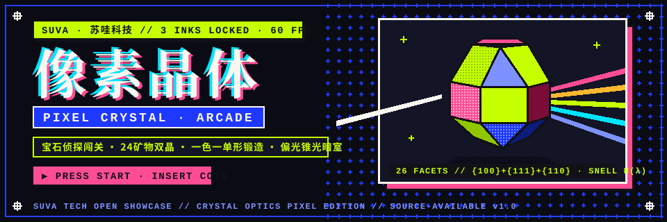
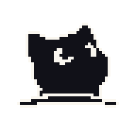
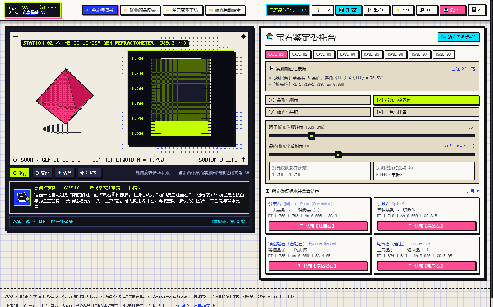
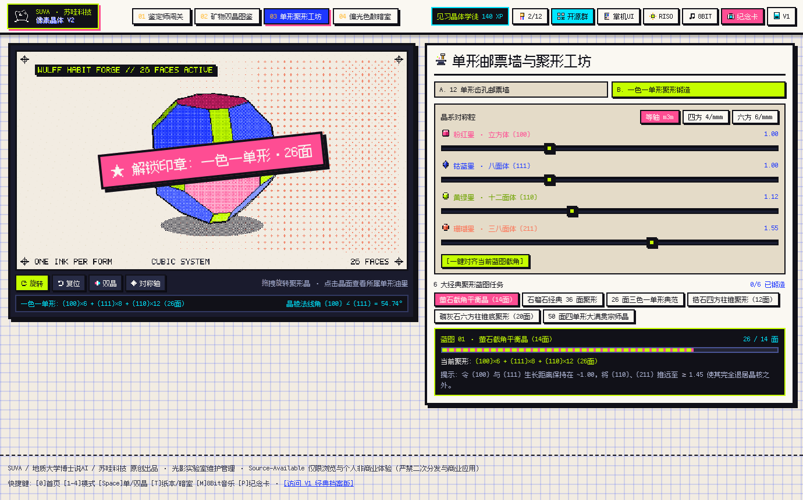
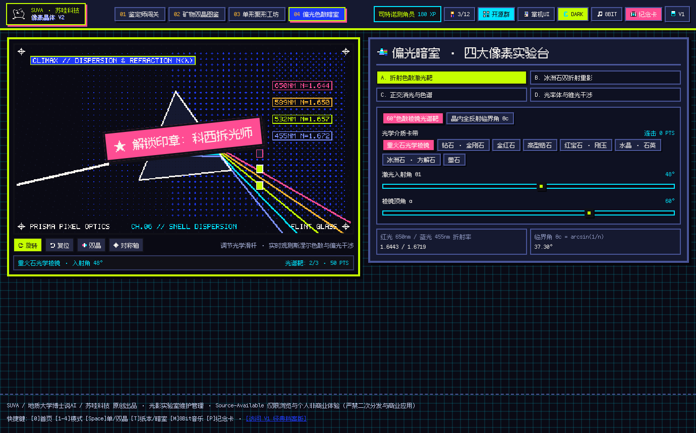
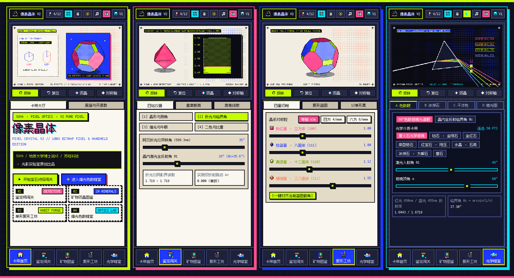
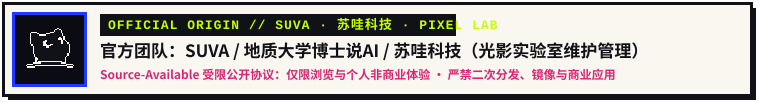

<div align="center">

<a href="https://yuyou-dev.github.io/PixelCrystal/">
  
</a>

<br/>



<p><b>官方团队：SUVA / 地质大学博士说AI / 苏哇科技</b> · <b>SUVA 光影实验室（Imaging Laboratory）维护管理</b></p>

<a href="https://yuyou-dev.github.io/PixelCrystal/">
  
</a>

<br/><br/>

[](https://github.com/yuyou-dev/PixelCrystal)
[](https://yuyou-dev.github.io/PixelCrystal/)
[](https://yuyou-dev.github.io/PixelCrystal/v1/)
[](./LICENSE)

**「把枯燥的晶体对称、一色一单形与偏光锥光干涉，装进一盘 60 FPS 100% 纯像素街机与掌机双屏卡带。」**  
由 **SUVA / 地质大学博士说AI / 苏哇科技** 原创出品 · 脱胎自《晶体小剧场》，融合 **PRISMA PIXEL OPTICS** 三色孔版（Risograph）与光学暗室像素短片视觉美学。


</div>

---

## 🗂️ 双版本在线体验 · V2 全像素旗舰版 & V1 经典保留版

本项目同时保留并维护两个在线交互版本，可在页面顶部导航栏一键互跳对比：

| 版本代号 | 在线试玩入口 | 核心定位与界面特征 |
| :--- | :--- | :--- |
| **`V2.1` · 100% 全像素街机 & 掌机双屏科学核查版（主推）** | 👉 **[yuyou-dev.github.io/PixelCrystal/](https://yuyou-dev.github.io/PixelCrystal/)** | **100% 纯像素化页面 + 全量双晶科学核查**：内嵌 `12×12` 点阵像素中文字库（`ArkPixel`），零系统平滑字体、零原生 Emoji；24 种矿物全部采用真实倒易点阵晶面法线与严谨双晶律/三维凹角投影（含罕见双晶对照与达碧兹扇区连生区分），搭配 SUVA 像素黑猫鉴定官与**专属零垂直滚动移动端掌机双屏界面**。 |
| **`V1.0` · 初代孔版档案版（完整保留）** | 👉 **[yuyou-dev.github.io/PixelCrystal/v1/](https://yuyou-dev.github.io/PixelCrystal/v1/)** | 完整保留初代三色孔版印刷（Risograph）混合排版网页版，作为视觉演进对照档案，同步共享 V2.1 底层 24 矿物严谨晶体几何与光学核心。 |

---

## 🕹️ V2 桌面端 100% 全像素实机演示 · PURE PIXEL WORKBENCH

<div align="center">

<a href="https://yuyou-dev.github.io/PixelCrystal/">
  
</a>

<br/><br/>


</div>

| `STAGE 01` · 宝石侦探社闯关（黑猫鉴定官） | `STAGE 02` · 24 矿物单晶 ↔ 双晶图鉴 |
| :---: | :---: |
| <br/><sub><b>SUVA 黑猫鉴定官 + 四站光学取证</b>：阿贝折光仪 `1.79 OTL`、全反射角、二色镜与锥光牛眼破获 8 桩主线悬案 + 无限随机委托</sub> | <br/><sub><b>7 大晶系 24 矿物全点阵排版</b>：`4×4 Bayer` 有序网点像素渲染，一键切换尖晶石 `{111}` 接触双晶经典 `141°04'` 凹入角</sub> |
| **`STAGE 03` · 一色一单形 26 面锻造台** | **`STAGE 04` · 暗室激光光学实验台** |
| <br/><sub><b>4 色像素宝石精灵 + 方形像素滑杆</b>：`粉红墨 {100}` × `钴蓝墨 {111}` × `黄绿墨 {110}` 实时半空间切削锻造 **26 面体**</sub> | <br/><sub><b>暗室物理真算</b>：柯西棱镜色散 `n(λ)` 激光靶、冰洲石双折射走离、CIE 1931 干涉色谱与石英旋光牛眼锥光图</sub> |

---

## 📱 专属移动端掌机双屏设计 · DEDICATED HANDHELD CONSOLE UI

拒绝把桌面网页做机械式的长条垂直堆叠滚动！在手机屏幕（`<= 860px` 自动激活，桌面端也可点击顶部 **`[掌机UI]`** 一键体验）下，《像素晶体 V2》切换为专为单手/双手拇指游玩设计的 **`100dvh` 零页面垂直滚动双屏掌机架构**：

<div align="center">
  <a href="https://yuyou-dev.github.io/PixelCrystal/">
    
  </a>
</div>

- **上屏恒定锁定（`16:9` 像素晶体显像框 + 4 枚硬件微动键）**：无论切换哪张实验面板，`480×270` 实时像素晶体舞台始终稳居掌机上屏，指尖随时拖拽旋转晶体、点击晶面测角，下方紧邻 `[旋转]`、`[复位]`、`[双晶]`、`[对称轴]` 四枚实体快捷微动键。
- **中段档案折耳签（Folder-Ear Sub-Tabs）**：将复杂光学面板拆解为轻量掌机折耳子页（如 `四站仪器 | 盖章断案 | 案卷线索`、`四墨切削 | 聚形蓝图 | 12单形票`、`A.色散靶 | B.冰洲石 | C.干涉色 | D.锥光图`），彻底告别冗长机械滚动。
- **底部五槽像素卡带坞（5-Slot Cartridge Dock）**：固定于拇指黄金热区的五枚自绘像素卡带槽（`卡带首页` / `鉴定闯关` / `矿物图鉴` / `聚形工坊` / `光学暗室`），秒级插拔切换玩法。

<div align="center">
  
</div>

---

## 🎮 四大街机卡带模式 · GAME MODES

### 1️⃣ `GEM DETECTIVE` · 宝石侦探社（核心闯关玩法）
搭档 **SUVA 像素黑猫鉴定官**，接手 **8 桩经典晶体学委托案 + 无限随机种子案件**（如「王冠上的千年替身：尖晶石 vs 红宝石」、「夜明珠碎裂悬案：萤石八面体 vs 钻石」、「维京太阳石重影密信：冰洲石 vs 石英」）：
- **四站多仪器光学取证**：晶形测角台、阿贝半球折光仪（含 `1.79` 接触液 `OTL` 超限警报与临界角激光）、正交偏光/贝克氏锥光牛眼镜、方解石二色镜与静水天平比重计。
- **火漆盖章结案与纯像素纪念卡导出**：锁定嫌疑矿物盖章断案，积累 `XP` 晋升鉴定师头衔、点亮 `12` 枚成就印章，并一键导出带 **SUVA 像素黑猫印章 + 开源群二维码** 的 `1280×720` 纯像素邮票纪念卡 `.png`。

### 2️⃣ `24 MINERAL CODEX` · 像素矿物与双晶图鉴（全量科学核查）
收录等轴、四方、六方、三方、斜方、单斜、三斜 **七大晶系共 24 种代表宝石与矿物**（金刚石、尖晶石、萤石、镁铝榴石、黄铁矿、锆石、金红石、锡石、海蓝宝石、祖母绿、磷灰石、水晶、方解石、红宝石、蓝宝石、电气石、托帕石、橄榄石、金绿宝石、坦桑石、石膏、正长石、蓝晶石、钠长石）：
- 一键切换 **`[单晶 SINGLE]` ↔ `[接触/穿插/轮式/聚片双晶 TWIN]`**，采用真实晶胞参数与倒易点阵晶面法线精确生成三维双晶多面体与三维投影凹角标注——包含金刚石/尖晶石 `{111}` `141°04'` 凹角、黄铁矿 `{110}` 铁十字穿插双晶、金红石 `{011}` `114°26'` 膝状双晶、锡石 `{011}` `112°09'` 锡嘴双晶、日本律水晶 `{112̄2}` `84°33'` 共面双晶、方解石 `{101̄1}` `90°45'` 蝴蝶双晶、金绿宝石 `{130}` 假六方轮式三连晶、石膏 `(100)` `131°48'` 燕尾双晶、正长石卡斯巴穿插双晶与钠长石 `{010}` 聚片五连双晶，并严格区分自然界罕见双晶对照（如电气石 `3m` `{101̄1}` `125°16'`）与哥伦比亚达碧兹祖母绿六扇区连生构造（详见 [`docs/SCIENCE.md`](./docs/SCIENCE.md)）。

### 3️⃣ `POLYHEDRON FORGE` · 一色一单形与聚形锻造台
- **12 枚齿孔邮票单形图章墙**：从单面、平行双面、四方/六方柱锥到立方体 `{100}`、八面体 `{111}`、菱形十二面体 `{110}`、四角三八面体 `{211}`、五角十二面体 `{210}`。
- **「一色一单形」实时半空间切削**：拖动方形像素滑杆调节各单形法向生长距离 `d_hkl`，亲手用荧光粉红 `{100}`、克莱因钴蓝 `{111}`、荧光黄绿 `{110}` 与珊瑚橙 `{211}` 交切锻造出 **14 面萤石平衡晶、36 面石榴石聚形与 50 面四单形大满贯宗师晶**！

### 4️⃣ `PRISMA DARKROOM` · 暗室光学实验台
- **折射色散激光靶**：调节入射角与棱镜顶角，实时解算柯西色散 `n(λ)` 劈出像素彩虹光束，对比钻石 `24.4°` 全内反射火彩临界角。
- **冰洲石双折射重影台**：基于坡印廷能流矢量计算寻常光 `o` 与非常光 `e` 的空间走离角，旋转方解石观测重影像素字公转。
- **米歇尔-莱维干涉色谱 & 三维锥光干涉台**：滑动晶片厚度 `d` 观测 CIE 1931 标准色度积分干涉色级序，实时渲染一轴晶黑十字、右旋/左旋水晶彩色牛眼心与二轴晶双曲线分合，支持插入 `+530 nm` 石膏试板判定光性正负！

---

## 📦 极简目录与本地运行 · MINIMAL REPOSITORY LAYOUT

仓库保持极简一级目录，打开首页即可直读本说明书，**零第三方 npm 运行时依赖**：

```text
PixelCrystal/
├── index.html          # V2 全像素街机 & 掌机双屏主入口（原生 ES Module 直载）
├── src/                # 核心引擎：Riso 调色板、晶体光学物理、多面体几何、像素光栅器、像素精灵库与纪念卡合成
├── assets/             # 点阵像素字库 (ArkPixel 12px)、SUVA 像素黑猫徽章、开源群二维码与实机截图动图
├── docs/               # 科学边界说明 (SCIENCE.md)、授权说明 (LICENSING.md)、保留版 V1 (docs/v1/) 与构建测试脚本
├── package.json        # npm test / npm run build / npm run serve（0 外部依赖）
├── LICENSE             # SUVA · 苏哇科技 受限公开协议（仅限浏览与个人非商业使用）
└── README.md           # 本像素卡带说明书
```

```bash
node docs/test.mjs            # 运行光学物理、24 矿物几何、SUVA 品牌资产与 V2 全像素契约测试（10/10 套件）
node docs/build.mjs --serve   # 构建 dist/（含 V2 主站 + /v1/ 保留版 + 单文件离线卡带）并启动本地预览
```

---

## ⚖️ 来源声明与低开放度开源协议 · ORIGIN & LICENSE

<div align="center">
  
</div>

- **原创出品与知识产权归属**：**SUVA / 地质大学博士说AI / 苏哇科技（SUVA Tech）** 原创研发，由 **SUVA 光影实验室（Imaging Laboratory）** 统一维护与版本演进管理。
- **低开放度受限公开（Source-Available, Non-Commercial, No-Redistribution）**：本项目采用 [`PixelCrystal Source-Available Personal Non-Commercial License 1.0`](./LICENSE)（非宽松开源协议），**仅允许在线浏览与个人非商业学习试玩，严禁任何形式的二次分发、镜像建站、商业应用或移除 SUVA 品牌标识**。第三方开源资产（CIE 1931 色度表 `CC BY-SA 4.0`、Ark Pixel 12px 点阵字体 `SIL OFL 1.1`）声明详见 [`docs/LICENSING.md`](./docs/LICENSING.md)。

---

## 💬 交流与联系 · 余博士开源技术群

欢迎对 **晶体光学可视化、计算宝石切磨、像素图形渲染与 AI 科研工具** 感兴趣的朋友扫码加入社群交流：

<table>
  <tr>
    <td align="center" width="240">
      
    </td>
    <td valign="middle">
      <p> &nbsp;<b>扫码加入「余博士开源技术群」</b></p>
      <ul>
        <li><b>官方团队</b>：SUVA / 地质大学博士说AI / 苏哇科技</li>
        <li><b>在线试玩（V2 全像素 & 掌机版）</b>：<a href="https://yuyou-dev.github.io/PixelCrystal/">https://yuyou-dev.github.io/PixelCrystal/</a></li>
        <li><b>经典对照（V1 孔版档案版）</b>：<a href="https://yuyou-dev.github.io/PixelCrystal/v1/">https://yuyou-dev.github.io/PixelCrystal/v1/</a></li>
        <li>使用反馈、教学交流或商业授权咨询，请通过左侧企业微信二维码入群或提交 GitHub Issue 联系。</li>
      </ul>
    </td>
  </tr>
</table>

<div align="center">


**Crafted in 100% Crisp Pixels, 3 Riso Inks & Snell's Law by SUVA · 苏哇科技**  
`© 2026 SUVA / 地质大学博士说AI / 苏哇科技 (SUVA Tech). All Rights Reserved.`

</div>
